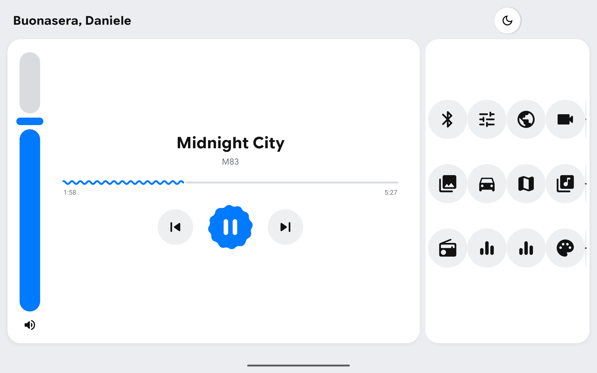
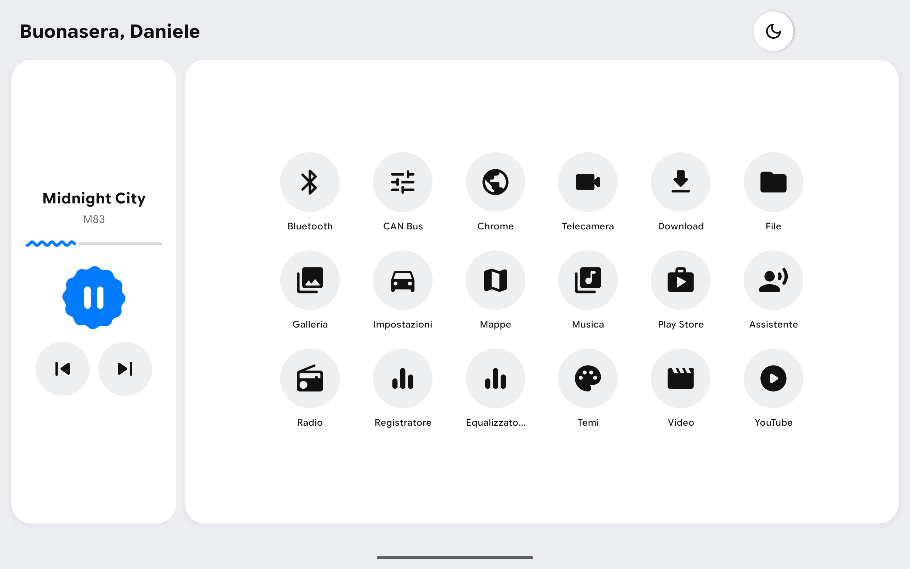

# Volkswagen Launcher

An Android launcher that replaces the home screen of the aftermarket head unit fitted to a VW Polo
6R. It's a single screen, landscape, built for use in the car: everything you need is within
thumb's reach without digging through menus.

## Screenshots

Media panel open:

App panel open:

## A few specs

- Hardware: XY Auto F9212B head unit (Allwinner T3 SoC, 2 GB of RAM), 1024×600 screen locked to
  landscape. It runs Android 10 AOSP, and it is neither Android Automotive nor Android Auto.
- App: Kotlin and Jetpack Compose, single module, `minSdk` 24. No ViewModel, no route-based
  navigation, no dependency injection: one `Activity` that mounts the screen.
- Light and night themes defined in-house, with a single blue accent. The system font scale is
  pinned to 1, so text sizing is the app's call and not the vehicle's settings.
- No ADB to install: copy the APK onto a USB stick and install it from the unit's file manager.

Hardware details live in [CAR.md](CAR.md), the code rules in [AGENTS.md](AGENTS.md).
